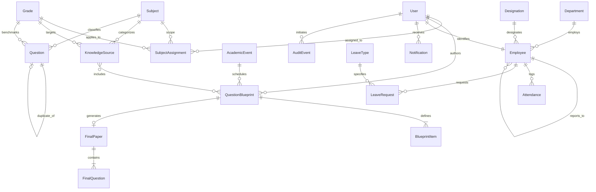

# Data Model Specification: STS Pulse

## 1. Entity-Relationship Overview

---

## 2. Core Models by Application

### 2.1 Academic Domain (`questionbank`)

#### `Subject`
- `name`: `CharField(max_length=120, unique=True)`
- `code`: `CharField(max_length=30, unique=True)`

#### `Grade`
- `name`: `CharField(max_length=50, unique=True)`
- `order`: `PositiveIntegerField(default=0)`

#### `SubjectAssignment`
- `user`: `ForeignKey(User, on_delete=CASCADE)`
- `subject`: `ForeignKey(Subject, on_delete=CASCADE)`
- `grade`: `ForeignKey(Grade, null=True, blank=True, on_delete=CASCADE)`
- *Constraint*: Unique `(user, subject, grade)`

#### `KnowledgeSource`
- `subject`: `ForeignKey(Subject, on_delete=PROTECT)`
- `grade`: `ForeignKey(Grade, null=True, blank=True, on_delete=PROTECT)`
- `title`: `CharField(max_length=255)`
- `material_type`: `CharField(choices=[textbook, syllabus, lesson_plan, sample_questions, notes])`
- `chapter`: `CharField(max_length=255, blank=True)`
- `topic`: `CharField(max_length=255, blank=True)`
- `file`: `FileField(upload_to="knowledge_sources/", max_length=500)`
- `content_text`: `TextField(blank=True)` (extracted text payload)
- `is_active`: `BooleanField(default=True)`
- `uploaded_by`: `ForeignKey(User, on_delete=SET_NULL, null=True)`

#### `Question`
- `subject`: `ForeignKey(Subject, on_delete=PROTECT)`
- `grade`: `ForeignKey(Grade, on_delete=PROTECT)`
- `question_type`: `CharField(choices=[mcq, short, long, true_false, fill_blank])`
- `difficulty`: `CharField(choices=[easy, medium, hard])`
- `text`: `TextField()`
- `options`: `JSONField(default=list, blank=True)`
- `answer`: `TextField()`
- `explanation`: `TextField(blank=True)`
- `source_reference`: `CharField(max_length=255, blank=True)`
- `status`: `CharField(choices=[draft, approved, rejected], default=draft)`
- `ai_generated`: `BooleanField(default=False)`
- `duplicate_of`: `ForeignKey('self', null=True, blank=True, on_delete=SET_NULL)`
- `created_by`: `ForeignKey(User, on_delete=PROTECT)`

#### `AcademicEvent`
- `title`: `CharField(max_length=255)`
- `event_type`: `CharField(choices=[term, exam_series, internal_exam, question_deadline, break, other])`
- `exam_series`: `CharField(max_length=100, blank=True)`
- `qualification`: `CharField(max_length=100, blank=True)`
- `start_date`: `DateField()`
- `end_date`: `DateField(null=True, blank=True)`
- `subject`: `ForeignKey(Subject, null=True, blank=True, on_delete=SET_NULL)`
- `grade`: `ForeignKey(Grade, null=True, blank=True, on_delete=SET_NULL)`

#### `QuestionBlueprint`
- `title`: `CharField(max_length=255)`
- `subject`: `ForeignKey(Subject, on_delete=PROTECT)`
- `grade`: `ForeignKey(Grade, on_delete=PROTECT)`
- `exam`: `ForeignKey(AcademicEvent, limit_choices_to={'event_type__in': [...]})`
- `assigned_to`: `ForeignKey(User, on_delete=PROTECT)`
- `due_date`: `DateField()`
- `duration_minutes`: `PositiveIntegerField(default=90)`
- `language`: `CharField(choices=[('en', 'English'), ('bn', 'Bangla')])`
- `sample_file`: `FileField(upload_to="blueprints/samples/", blank=True)`
- `materials`: `ManyToManyField(KnowledgeSource, blank=True)`
- `instructions`: `TextField(blank=True)`
- `guidance`: `TextField(blank=True)`
- `status`: `CharField(choices=[draft, in_review, returned, approved, finalized])`

#### `BlueprintItem`
- `blueprint`: `ForeignKey(QuestionBlueprint, related_name='items', on_delete=CASCADE)`
- `order`: `PositiveIntegerField(default=1)`
- `section`: `CharField(max_length=50)`
- `question_type`: `CharField(choices=[...])`
- `difficulty`: `CharField(choices=[...])`
- `topic`: `CharField(max_length=255, blank=True)`
- `count`: `PositiveIntegerField(default=1)`
- `marks_each`: `PositiveIntegerField(default=1)`
- `sample_question`: `TextField(blank=True)`

#### `FinalPaper` (Strictly Confidential)
- `blueprint`: `OneToOneField(QuestionBlueprint, on_delete=PROTECT, related_name='final_paper')`
- `status`: `CharField(choices=[generated, locked], default=generated)`
- `model_used`: `CharField(max_length=100)`
- `generated_by`: `ForeignKey(User, related_name='generated_papers')`
- `generated_at`: `DateTimeField(auto_now_add=True)`
- `locked_by`: `ForeignKey(User, null=True, blank=True, related_name='locked_papers')`
- `locked_at`: `DateTimeField(null=True, blank=True)`
- `controller_notes`: `TextField(blank=True)`
- `generation_started_at`: `DateTimeField(null=True, blank=True)`
- `generation_error`: `TextField(blank=True)`
- `check_summary`: `JSONField(default=dict, blank=True)`

#### `FinalQuestion` (Strictly Confidential)
- `paper`: `ForeignKey(FinalPaper, related_name='questions', on_delete=CASCADE)`
- `order`: `PositiveIntegerField(default=1)`
- `section`: `CharField(max_length=50)`
- `question_type`: `CharField(max_length=30)`
- `text`: `TextField()`
- `options`: `JSONField(default=list, blank=True)`
- `answer`: `TextField()`
- `explanation`: `TextField(blank=True)`
- `marks`: `PositiveIntegerField(default=1)`
- `source_reference`: `CharField(max_length=255, blank=True)`
- `check_notes`: `TextField(blank=True)`

---

### 2.2 Human Resources Domain (`hr`)

#### `Department`
- `name`: `CharField(max_length=100, unique=True)`
- `head`: `ForeignKey(User, null=True, blank=True, on_delete=SET_NULL)`

#### `Designation`
- `name`: `CharField(max_length=100, unique=True)`

#### `Employee`
- `user`: `OneToOneField(User, on_delete=PROTECT, related_name='employee')`
- `employee_id`: `CharField(max_length=30, unique=True)`
- `department`: `ForeignKey(Department, on_delete=PROTECT)`
- `designation`: `ForeignKey(Designation, on_delete=PROTECT)`
- `reports_to`: `ForeignKey('self', null=True, blank=True, on_delete=SET_NULL)`
- `joining_date`: `DateField()`
- `contact_number`: `CharField(max_length=30, blank=True)`
- `is_active`: `BooleanField(default=True)`

#### `Holiday`
- `date`: `DateField(unique=True)`
- `name`: `CharField(max_length=150)`

#### `Attendance`
- `employee`: `ForeignKey(Employee, on_delete=CASCADE)`
- `date`: `DateField()`
- `status`: `CharField(choices=[present, late, half_day, absent, on_leave])`
- `check_in`: `TimeField(null=True, blank=True)`
- `check_out`: `TimeField(null=True, blank=True)`
- `note`: `CharField(max_length=255, blank=True)`
- *Constraint*: Unique `(employee, date)`

#### `LeaveType`
- `name`: `CharField(max_length=100, unique=True)`
- `days_per_year`: `PositiveIntegerField(default=0)`
- `is_paid`: `BooleanField(default=True)`

#### `LeaveRequest`
- `employee`: `ForeignKey(Employee, on_delete=CASCADE)`
- `leave_type`: `ForeignKey(LeaveType, on_delete=PROTECT)`
- `start_date`: `DateField()`
- `end_date`: `DateField()`
- `days`: `DecimalField(max_digits=5, decimal_places=1)`
- `reason`: `TextField()`
- `status`: `CharField(choices=[pending, approved, rejected, cancelled], default=pending)`
- `reviewed_by`: `ForeignKey(User, null=True, blank=True, on_delete=SET_NULL)`
- `reviewed_at`: `DateTimeField(null=True, blank=True)`

---

### 2.3 Shared Infrastructure Models

#### `Notification` (`notifications`)
- `recipient`: `ForeignKey(User, on_delete=CASCADE, related_name='notifications')`
- `kind`: `CharField(choices=[approval, reminder, success, warning, info])`
- `title`: `CharField(max_length=200)`
- `body`: `TextField()`
- `url`: `CharField(max_length=500, blank=True)`
- `is_read`: `BooleanField(default=False)`
- `dedupe_key`: `CharField(max_length=100, null=True, blank=True)`
- `created_at`: `DateTimeField(auto_now_add=True)`
- *Constraint*: Unique `(recipient, dedupe_key)` (NULL allowed for non-deduped messages)

#### `AuditEvent` (`audit`)
- `created_at`: `DateTimeField(auto_now_add=True)`
- `actor`: `ForeignKey(User, null=True, on_delete=SET_NULL)`
- `actor_name`: `CharField(max_length=150, blank=True)`
- `action`: `CharField(max_length=50)` (Choices from `AuditEvent.Action`)
- `target_type`: `CharField(max_length=100)`
- `target_id`: `CharField(max_length=50)`
- `target`: `CharField(max_length=255)`
- `details`: `JSONField(default=dict, blank=True)`
- `ip_address`: `GenericIPAddressField(null=True, blank=True)`

